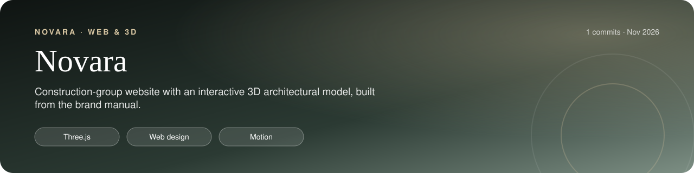
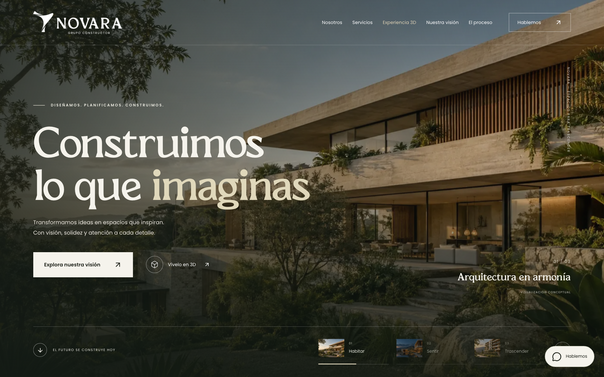
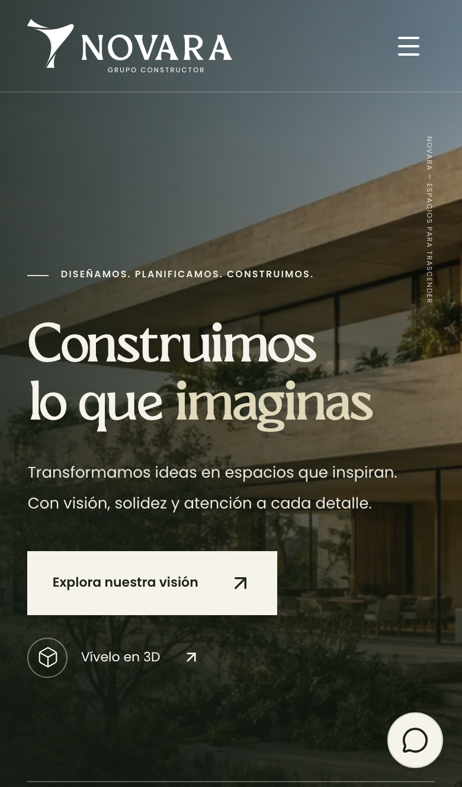

<p align="center"></p>

<p align="center">   </p>

<h1 align="center">Novara Grupo Constructor</h1>
<!-- /header -->

Sitio web de Novara, creado a partir de su manual de identidad y sus recursos oficiales. La segunda versión incorpora fotografía ampliada, movimiento y una maqueta arquitectónica interactiva. Proyecto independiente en Next.js, React, TypeScript y Three.js.

## At a glance

<table>
  <tr>
    <td align="center" width="33%"><b>novara-gules.vercel.app</b><br>Live</td>
    <td align="center" width="33%"><b>Interactive 3D architectural model</b><br>Highlight</td>
    <td align="center" width="33%"><b>Official brand identity manual</b><br>Built from</td>
  </tr>
</table>

## Screenshots

<p align="center">
  
  
</p>
<p align="center"><sub>Desktop · Mobile</sub></p>

## Desarrollo

```sh
npm ci
npm run dev
```

Vista previa: http://localhost:3002. El servidor utiliza el puerto 3002 para convivir con otros proyectos locales.

```sh
npm run build
npm run start
npm run typecheck
npm run test:e2e
node scripts/preview.mjs
```

Las pruebas requieren Chromium de Playwright (`npx playwright install chromium`). Las capturas se guardan en `artifacts/`.

## Contenido y funcionamiento

- Identidad Novara: colores oficiales, imagotipo original, El Pacre y Poppins.
- Inicio, presentación de la constructora, servicios desplegables, galería de inspiración con filtros y fichas, proceso, contacto y enlaces comerciales.
- Datos comerciales transcritos de `brand/source/membrete.docx`: +57 312 818 8085, gerencia@novaraconstructora.com, CC Pasaje Solano, local 1–15, Duitama, Boyacá.
- El formulario valida los campos y prepara una consulta. El usuario revisa el mensaje y abre WhatsApp para enviarlo. No existe un envío automático ni una base de datos de contactos. Los datos del formulario permanecen en memoria del navegador hasta abrir WhatsApp, copiarlos o descargarlos.
- Navegación móvil, soporte de teclado, cierre de fichas con Escape, movimiento reducido e imágenes locales optimizadas.
- Portada con tres escenas, transición fotográfica, movimiento de cámara, respuesta al cursor, selección manual y pausa. El avance automático se detiene al salir de pantalla, cambiar de pestaña o enfocar contenido; la preferencia de movimiento reducido desactiva la reproducción inicial.
- Maqueta 3D original: arrastrar o usar flechas para girar, cambiar entre Arena/Oliva/Terracota, separar niveles con un deslizador, acercar/alejar y restablecer vista. Se importa al acercarse a la sección y suspende el renderizado fuera de pantalla. Incluye alternativa ilustrada cuando WebGL no está disponible.
- Seis conceptos con filtros y fichas, recorrido fotográfico horizontal con botones/teclado/deslizamiento, imágenes en la presentación de marca, progreso de lectura y aparición de secciones.

Los textos, servicios, datos de contacto y conceptos están en `src/data/site.ts`. La interfaz está en `src/components/novara-site.tsx` y los estilos en `src/app/globals.css`.

La segunda versión añade `src/app/experience.css`, `hero-experience.tsx`, `architecture-experience.tsx`, `architecture-scene.ts` y `visual-journey.tsx`. La maqueta utiliza geometría local y no requiere archivos de modelos ni servicios externos. Las capturas de la primera versión se conservaron en `artifacts/version-1/`.

## Publicación

Sitio público: https://novara-gules.vercel.app

Proyecto de Vercel: `mente-sana-psicologia/novara`. Esta carpeta está vinculada mediante `.vercel/project.json` (ignorado por Git). Para actualizar la versión publicada:

```sh
vercel deploy --prod --yes --scope mente-sana-psicologia
node scripts/check-deployment.mjs https://novara-gules.vercel.app
PLAYWRIGHT_BASE_URL=https://novara-gules.vercel.app npm run test:e2e
```

`.vercelignore` excluye material original, capturas, pruebas y variables locales. Los metadatos usan el dominio de producción proporcionado por Vercel, con posibilidad de sobrescribirlo mediante `NEXT_PUBLIC_SITE_URL`. Los conceptos continúan identificados y la web conserva `noindex, nofollow`.

Durante la publicación se actualizó Next.js a `16.3.5`; la instalación auditada terminó con 0 vulnerabilidades reportadas. Las comprobaciones del enlace público se registran en `artifacts/deployment-check.json`.

## Pendientes de contenido y dominio definitivo

1. Reemplazar o complementar la galería de inspiración con fotografías, nombres y datos verificados de proyectos de Novara. Las imágenes actuales están identificadas como conceptos o referencias y no como obras realizadas.
2. Validar con Novara que los datos del membrete siguen vigentes y confirmar el alcance comercial de los servicios.
3. Confirmar la licencia web/comercial de El Pacre: el archivo suministrado se llama `el-pacre-personal-use.regular.otf`. Se conserva para esta propuesta local; no se ha adquirido una licencia adicional. Poppins usa la licencia SIL OFL incluida junto a la fuente.
4. Configurar `NEXT_PUBLIC_SITE_URL` con el dominio definitivo y cambiar `robots` en `src/app/layout.tsx` cuando se apruebe la indexación. Esta propuesta utiliza `noindex, nofollow`.

La web está publicada en el dominio de Vercel. No se ha conectado un dominio personalizado. El repositorio Git es local.

## Recursos

Origen, imágenes generadas y prompts: [brand/ASSETS.md](brand/ASSETS.md).
